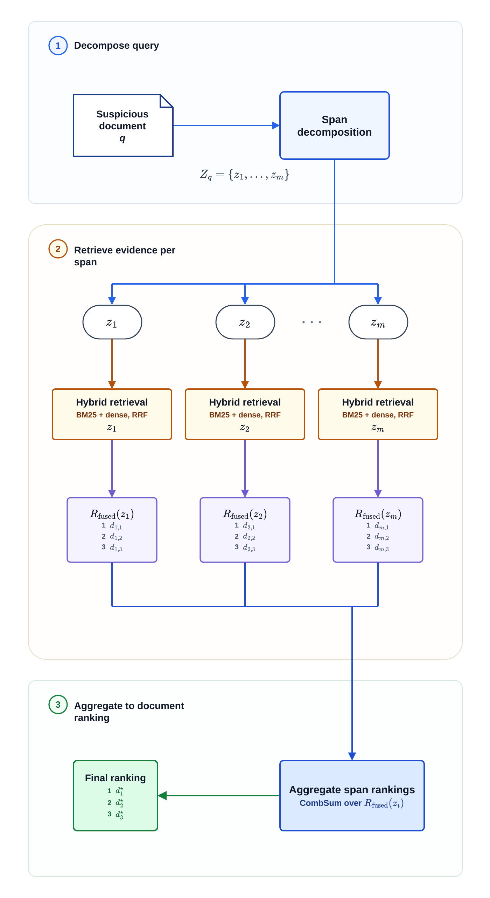

<h1>Team JLP at PAN 2026: Span-Based Hybrid Source Retrieval for Generative Plagiarism Detection</h1>

<a href="https://orcid.org/0009-0002-9221-7655">Liam Kaan Cody</a>1,*,
Peter Felix Panzitt1,*,
James Ernst Cox1,*

1 Graz University of Technology 
* Equal contribution

lcody@student.tugraz.at, peter.panzitt@student.tugraz.at, james.cox@student.tugraz.at

## 📄 Abstract 

The PAN 2026 generative plagiarism detection task asks systems to recover the source papers used to produce a scientific article written by a large language model. We address this source retrieval problem with a span-based hybrid retrieval system. Instead of representing each suspicious article as one long query, the system decomposes it into sentence-level queries so that local source evidence is not diluted by the full document.

Each sentence is searched against a full-document BM25 index and a dense index built over structure-aware chunks of the source corpus. Sparse and dense rankings are fused with Reciprocal Rank Fusion, and sentence-level evidence is aggregated into a final source-document ranking with CombSUM.

Since no labeled development set was released, we created a 200-query synthetic development set from the source corpus to select span and fusion settings. On this synthetic set, the selected hybrid run reached nDCG@10 of `0.9893` and Recall@10 of `0.9950`. On the official test set of 200 suspicious documents, the primary submission achieved Recall@10 of `0.8542` and nDCG@10 of `0.7994`, ranking first among submitted systems.

## 🔎 Overview 

  
  
<em>Figure 1: System architecture.</em>

The system was built for scientific source retrieval, but most of the pipeline is not specific to scientific papers. The domain-specific part is mainly how the source corpus is indexed and chunked. The same idea, splitting a long query document into local spans, retrieve with sparse and dense methods, then fuse the evidence, should also work for other Query-by-Document retrieval tasks.

## 📚 Citation

The paper citation will be added when the PAN 2026 proceedings are available.
